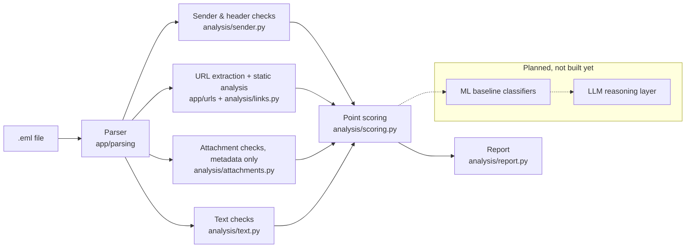

# Phishing Email Detector

**In short:** a Python command-line tool that reads an email file and labels it **legitimate**, **suspicious**, or **phishing**, and shows exactly why. Every point in the score is tied to a specific piece of evidence, and the report keeps verifiable facts ("this link goes to a different site than its text says") apart from judgments ("this looks deceptive"). It analyzes emails without ever opening links or attachments. It is an early-stage, rule-based project, not a production filter. See [Status and limitations](#status-and-limitations).

## What it does

Given a raw `.eml` file, the tool parses the headers, bodies, links, and attachment metadata, then runs a set of transparent rules over them: sender and header checks (Reply-To mismatch, brand names in the display name, SPF/DKIM failures), static link analysis (lookalike domains, homographs, link text that disagrees with the real target, raw IPs, shorteners), attachment-name checks (risky and double extensions), and keyword checks on the wording (urgency, requests for credentials or payment). Each rule that fires adds a documented number of points and contributes evidence to the report. The total maps to a verdict through fixed thresholds.

## Run the demo

Requires Python 3.12. From the repo root:

```bash
python3 -m venv .venv
source .venv/bin/activate
pip install -r requirements.txt

python -m pytest                                              # run the test suite
python -m app.analysis tests/fixtures/phishing_sample.eml    # analyze the phishing sample
python -m app.analysis tests/fixtures/benign_sample.eml      # analyze the benign sample
```

Both sample emails are synthetic and use reserved `.example` / `.test` domains only.

Other entry points for inspecting single stages:

```bash
python -m app.parsing tests/fixtures/phishing_sample.eml   # parsed email as JSON
python -m app.urls tests/fixtures/phishing_sample.eml      # URL analysis only
```

## Example output

Real output of `python -m app.analysis tests/fixtures/phishing_sample.eml`:

```text
Classification: PHISHING
Risk score: 100/100 (rule-based, not calibrated)
Recommended action: quarantine

Observed facts:
  - (sender) Reply-To domain collect-mail[.]example differs from From domain micros0ft-support[.]example
  - (sender) Sender display name mentions microsoft but the address is at micros0ft-support[.]example
  - (sender) Authentication-Results header records spf=fail
  - (url) Link text shows microsoft[.]com but the link goes to micros0ft-support[.]example
  - (url) Link goes to micros0ft-support[.]example, which is not a known microsoft domain
  - (url) A link uses unencrypted HTTP

Assessments:
  - (sender) Display names are chosen freely by the sender; this one claims a brand the address doesn't belong to
  - (url) Link text naming a different site than the real target is a strong deception signal
  - (url) Domain appears to imitate microsoft (lookalike characters)
  - (text) Wording creates urgency or threat (matched: 'urgent', 'suspended', 'in 24 hours')

Score breakdown:
  +15  reply_to_mismatch
  +20  display_name_brand
  +15  spf_fail
  +30  anchor_mismatch
  +25  brand_lookalike
  +5   plain_http
  +10  urgency
  = 120 (capped at 100)
Thresholds: suspicious >= 25, phishing >= 50
```

Real output of `python -m app.analysis tests/fixtures/benign_sample.eml`:

```text
Classification: LEGITIMATE
Risk score: 0/100 (rule-based, not calibrated)
Recommended action: deliver

Observed facts:
  (none)

Assessments:
  (none)

Score breakdown:
  (no rules fired)
  = 0
Thresholds: suspicious >= 25, phishing >= 50
```

## Architecture

What is built today, with the planned layers shown separately:



| Package | Role |
|---|---|
| `app/parsing/` | Turns raw `.eml` bytes into a `ParsedEmail`: headers, text and HTML bodies, `<a>` links with their visible text, attachment metadata. Extracts facts only. |
| `app/urls/` | Collects URLs from the HTML and plain-text bodies and computes static features for each (registered domain, brand imitation, homographs, IP hosts, and more). |
| `app/analysis/` | The rule-based analyzer: sender, link, attachment and text rules, point scoring, and the terminal report. |
| `app/schemas.py` | Shared contracts: `Evidence` (observed or assessment) and `SecurityReport`. |

## Design and security choices

The tool handles hostile input by design, so these are deliberate constraints:

- **Static analysis only.** No network calls, no DNS lookups, no URL fetching, no HTML rendering. Domain parsing uses `tldextract` configured with `suffix_list_urls=()` so it never downloads anything and uses only its bundled suffix list.
- **Defanged URLs in output.** Domains and URLs are printed as `micros0ft-support[.]example` / `hxxp://...` so nothing in the output is clickable.
- **Attachments are never opened.** The parser records only the file name, content type, size, and SHA-256 hash. Attachment rules look at the file name alone.
- **Email content is data, not instructions.** Bodies and headers are only parsed and pattern-matched; nothing from an email is executed, rendered, or followed.
- **Input caps.** Emails over 10 MB are rejected, bodies are truncated at 200,000 characters, and at most 50 URLs of up to 2,048 characters each are analyzed.
- **Observed facts vs. assessments.** Every piece of evidence is labeled either `OBSERVED` (a fact anyone can verify in the email) or `ASSESSMENT` (a judgment by a rule). Wording checks are always assessments.
- **Authentication-Results is treated as forgeable.** Any server on the delivery path, including an attacker's, can add this header. SPF/DKIM failures are recorded as "the header says X", not as proof.
- **Terminal-safe printing.** Attachment names are attacker-controlled, so they are printed with escapes, and non-printable characters in report text are replaced, so an email can't inject terminal control codes.
- **No points without evidence.** A rule result with no evidence is rejected by validation, so every point in the score is explained in the report.

## How scoring works

Each rule adds its points **at most once per email**, so a link repeated five times scores once. The raw total is capped at 100. Values come from `app/analysis/rules.py`.

| Rule | Points | Reason |
|---|---:|---|
| **Links** | | |
| `dangerous_scheme` | 40 | `javascript:`/`data:` links can run code; no legitimate email needs one |
| `anchor_mismatch` | 30 | Visible link text names a different site than the real target |
| `brand_lookalike` | 25 | Link domain imitates a known brand (lookalike characters, typo, subdomain) |
| `userinfo_trick` | 25 | Text before `@` in a URL disguises the real host |
| `mixed_script` | 20 | One domain label mixes alphabets: homograph attack |
| `ip_host` | 20 | Real organizations almost never link to a bare IP address |
| `shortener` | 10 | Hides the destination, but marketing mail uses shorteners too |
| `plain_http` | 5 | Unencrypted link; weak on its own |
| `suspicious_tld` | 5 | Frequently abused ending such as `.xyz`; weak on its own |
| `nonstandard_port` | 5 | Unusual port; weak on its own |
| **Sender and headers** | | |
| `reply_to_mismatch` | 15 | Replies go to a different domain; some helpdesks do this legitimately |
| `display_name_brand` | 20 | Display name claims a brand the sending address doesn't belong to |
| `spf_fail` | 15 | Sending server not authorized for the envelope domain |
| `dkim_fail` | 15 | Message signature missing a valid match or altered in transit |
| **Attachments (metadata only)** | | |
| `double_extension` | 40 | e.g. `invoice.pdf.exe`: a program disguised as a document |
| `risky_extension` | 30 | File types that run code when opened (`.exe .scr .js .iso .lnk`) |
| **Text (always ASSESSMENT)** | | |
| `credential_request` | 20 | Asks for passwords, account verification, or payment |
| `urgency` | 10 | Pressure or threats; legitimate mail uses these words too, so low weight |

`double_extension` and `risky_extension` never both apply to the same email.

**Thresholds:**

| Score | Verdict | Action |
|---|---|---|
| 0–24 | legitimate | deliver |
| 25–49 | suspicious | warn |
| 50–100 | phishing | quarantine |

A single rule worth 25 or more points (such as `anchor_mismatch` or `brand_lookalike`) reaches suspicious on its own; rules worth less than 25 need other signals to add up; two high-weight rules together reach phishing. These are hand-picked starting values, not tuned on data.

## Status and limitations

- **Rule-based only.** There is no machine-learning or LLM component yet.
- **The score is uncalibrated.** It is a sum of hand-assigned points, not a probability, and the thresholds are untuned guesses.
- **Tested only on synthetic emails** using reserved `.example` / `.test` domains. It has **not been evaluated on real phishing data**, and no accuracy, precision, or recall claims are made.
- **The brand list is small and hand-curated** (15 brands in `app/urls/brands.py`), so impersonation of other brands is not detected by name.
- Keyword checks match fixed English phrases and are easy to evade by rewording.
- SPF/DKIM results are read from a header that can be forged; the tool does not verify them itself.
- **Not built yet:** ML layer, LLM layer, screenshot analysis, dataset pipeline.

## Roadmap

Planned, not done:

1. **Dataset ingestion** with group-aware splits, so near-identical emails from one campaign never land in both training and test data.
2. **ML baselines** with a proper evaluation harness; any reported numbers will come from real runs.
3. **An LLM reasoning layer** over the structured evidence, with prompt-injection defenses: email text passed only as delimited data, no tools for the model, schema-validated output that fails closed to "suspicious".
4. **Sandboxed screenshot analysis** of linked pages, run only inside a locked-down container.
